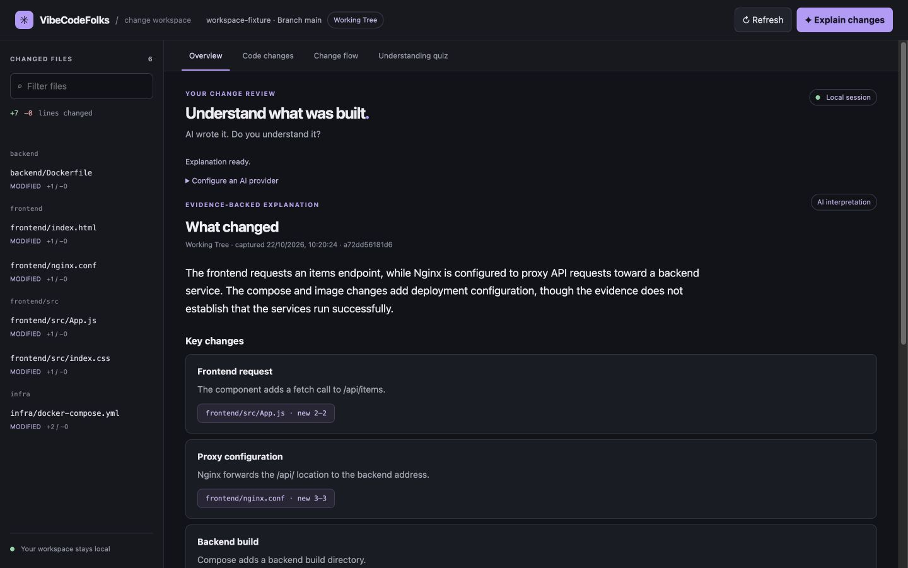
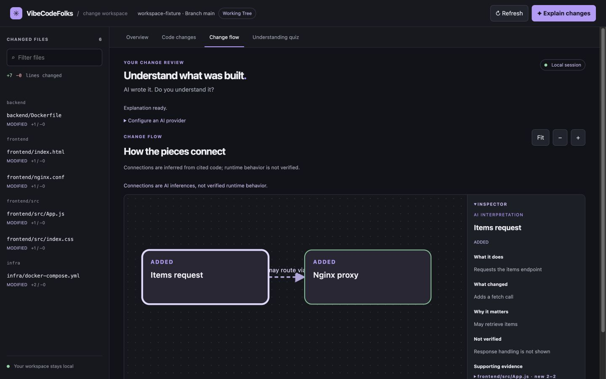
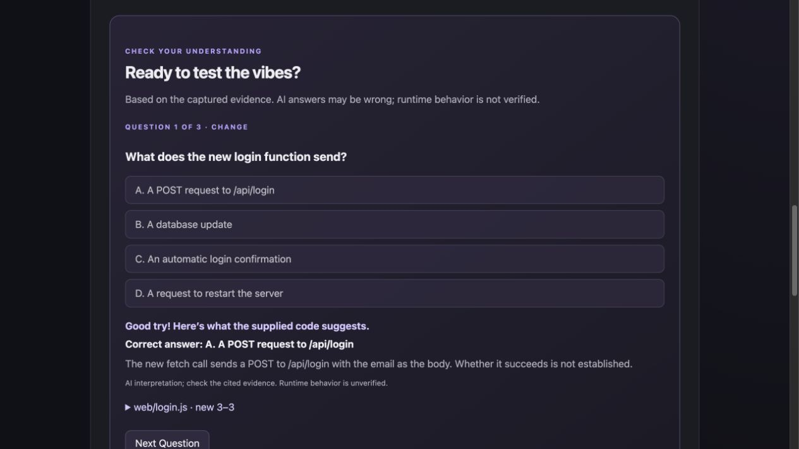

# VibeCodeFolks

**AI wrote it. Do you understand it?**

VibeCodeFolks is a local tool for understanding code changes made by AI coding agents. Point it at a Git repository, review the changes, and ask an AI provider to explain the evidence. Explore a change map and check your understanding with a short quiz.

One Go executable. A local browser dashboard. No database, frontend runtime, or account required.

> **Early beta:** AI explanations, connections, and quiz answers can be wrong. Review the cited code and run your own tests. Start with repositories that contain no sensitive information.



The screenshots use a fictional local repository and a scripted local provider; no private source or credentials were used.

## Install

Git is required. On macOS or Linux, install the latest stable release:

```sh
curl -fsSL https://raw.githubusercontent.com/BHAVIKA44/vibecodefolks/main/install.sh | sh
```

Executing a remote shell script requires trusting its source. You can inspect [install.sh](install.sh) first, or download the archive and `checksums.txt` from [Releases](https://github.com/BHAVIKA44/vibecodefolks/releases), verify its SHA-256 checksum, and extract the executable yourself. The installer writes to `~/.local/bin`; set `VIBECODEFOLKS_INSTALL_DIR` to choose another directory, or `VIBECODEFOLKS_VERSION=v0.1.0` to select a version. Add the installation directory to your PATH if necessary. No sudo or shell-profile changes are made. For the current shell, run `export PATH="$HOME/.local/bin:$PATH"` (or substitute your custom directory).

On Windows PowerShell, install a verified v0.1.0 archive (Git must already be installed):

```powershell
$tag = 'v0.1.0'
$asset = "vibecodefolks_${tag}_windows_amd64.zip"
$base = "https://github.com/BHAVIKA44/vibecodefolks/releases/download/$tag"
$dir = Join-Path $env:USERPROFILE '.local\bin'
New-Item -ItemType Directory -Force $dir | Out-Null
$tmp = Join-Path ([System.IO.Path]::GetTempPath()) ([System.Guid]::NewGuid().ToString())
New-Item -ItemType Directory $tmp | Out-Null
try {
  Invoke-WebRequest "$base/$asset" -OutFile "$tmp/$asset"
  Invoke-WebRequest "$base/checksums.txt" -OutFile "$tmp/checksums.txt"
  $lines = @(Get-Content "$tmp/checksums.txt" | Where-Object { $_.EndsWith("  $asset") })
  if ($lines.Count -ne 1 -or $lines[0] -notmatch '^[0-9a-f]{64}  ') { throw 'Missing or invalid checksum' }
  if ((Get-FileHash "$tmp/$asset" -Algorithm SHA256).Hash.ToLower() -ne $lines[0].Substring(0, 64)) { throw 'Checksum mismatch' }
  Expand-Archive "$tmp/$asset" -DestinationPath "$tmp/extracted"
  Move-Item -Force "$tmp/extracted/vibecodefolks.exe" "$dir/vibecodefolks.exe"
} finally { Remove-Item -Recurse -Force $tmp }
& "$dir/vibecodefolks.exe" --version
```

Windows users can run `& "$env:USERPROFILE/.local/bin/vibecodefolks.exe" .` or add that directory to PATH. The binaries are unsigned; follow your operating system's normal security prompts. The executable embeds the dashboard and requires no Go, Node.js, Python, Electron, database, or account at runtime.

## Quick start

```sh
vibecodefolks .
# Optional: don't open a browser automatically
vibecodefolks --no-open /path/to/project
```

The path can point anywhere inside a Git repository; omit it for the current directory. The dashboard listens on `127.0.0.1`. Open the printed URL if necessary and press Ctrl+C to stop the server.

## How it works

1. An AI coding agent changes your repository.
2. Run VibeCodeFolks and inspect the Git changes in your browser.
3. Select the locally installed Codex harness or configure an AI provider, review the evidence preview, and choose whether to send it.
4. Explore the explanation and change map, then try the optional quiz.

## Features

- Inspect working-tree Git changes or, when clean, the last commit.
- Review bounded code evidence before sending it to a configured provider.
- Work through an overview, cited code changes, an optional inferred flow, and an understanding quiz.
- Run locally without a database, cloud service, or frontend runtime dependency.

## Git changes

The dashboard shows the combined working-tree diff from `HEAD`, plus untracked non-ignored files. When the tree is clean it displays **Last Commit**, compared to its first parent. Initial commits, repositories without commits, detached HEAD, renames, and binary files are supported. Refresh reruns Git analysis. Changes canceled between the index and working tree can have no combined difference; a warning is shown. Staged deletions followed by an untracked replacement are shown once with unavailable net statistics.

## Optional AI explanation

The dashboard's **Codex (local)** option follows the local-harness model: it uses an already installed and authenticated Codex CLI, so VibeCodeFolks does not receive or save an API key. It sends only the evidence shown in the preview and starts Codex in a temporary, read-only directory. The local CLI remains responsible for its account, selected model, and provider access.

Direct HTTP providers remain available when you prefer them. Configure them in the dashboard for the current session, or set these environment variables before starting the CLI:

Set these environment variables before starting the CLI:

```sh
export VIBECODEFOLKS_AI_ENDPOINT="https://generativelanguage.googleapis.com/v1beta/openai/chat/completions"
export VIBECODEFOLKS_AI_MODEL="your-available-gemini-model"
# Set VIBECODEFOLKS_AI_API_KEY securely in your shell, without sharing it.
vibecodefolks /path/to/project
```

Use the provider's full chat-completions URL. Remote endpoints require HTTPS and an API key; loopback endpoints can use HTTP and do not require a key. Providers must support OpenAI-compatible chat completions and structured JSON responses. Groq uses its strict JSON Schema mode. No AI request is made when the dashboard opens. Click **Explain Changes**, review the evidence and provider details, then explicitly send it. Remote providers require the consent checkbox. Canceling a provider request cancels the HTTP call where possible.

The server collects unified diff hunks with three lines of surrounding context, including untracked additions, and up to eight straightforward single-line import statements from each current file. It sends the selected file paths, diff excerpts, line references, scope, and limitations to the provider. It excludes binary files, symlinks, common credential filenames, detected secret patterns, oversized files and diffs, and files beyond configured limits. At most 20 files, 32 KiB per file/diff, and 160 KiB total diff text are included. The serialized provider evidence is additionally capped at 512 KiB. Skipped files and reasons are displayed. Secret detection is **best effort** and cannot guarantee all sensitive information is removed: inspect the preview before sending. Your provider may retain submitted data. The local server does not log source snippets, prompts, or keys.

Git filter and filesystem monitor commands are disabled during analysis. The server listens only on `127.0.0.1`, checks the request host and origin, and does not accept arbitrary project paths via the API. It is designed for a trusted local machine, not as a multi-user server.

### Visual change flows

After the explanation is ready, the change map uses the same evidence snapshot to show suggested components and connections. Select a card or arrow with the mouse or keyboard to see its description, uncertainty, and supporting diff excerpts. For example, a change to `web/login.js` and `api/auth.py` might show **Login form → Authentication API** when both files contain relevant evidence. The arrow is an AI inference; matching paths do not prove the request works at runtime. The screenshot below uses a scripted mock provider and a sample repository.



The snapshot timestamp and identifier describe the evidence sent to the provider. Refreshing Git changes clears the previous explanation and diagram; run **Explain Changes** again to analyze the new snapshot. If a graph is omitted, unreadable, fails evidence checks, or has no supported connection, the explanation remains available and the flow says why it is unavailable. It never substitutes generic file cards or invents connections. Currently all displayed connections are AI inferences; no deterministic relationship extraction is performed. The map accepts at most 20 nodes and 30 edges, so larger changes may be summarized or have no supported flow. Use Fit and zoom controls and scroll the diagram for larger flows.

### Understanding quiz

After an explanation is generated, choose **Okay bro, did you actually understand it? 💀** to practice with up to five multiple-choice questions about the supplied code evidence. The same AI request produces the explanation, diagram, and optional quiz; starting or retrying a quiz does not send code to the AI provider again. If the evidence or model response cannot support a quiz, the dashboard says so and the explanation remains available.

Each answer receives immediate feedback, an AI-generated explanation, and expandable source references. The final score is the number of correct choices out of the questions presented. Answers and scores remain in the current browser session. Retry starts a new attempt with the same questions. The app checks the local evidence snapshot before starting or retrying; refresh clears the current quiz and score.



Questions and answer keys are AI interpretations. The server checks their format and cited lines, but cannot guarantee factual correctness or verify behavior at runtime. Review the cited code, and run appropriate tests. The score is a learning aid, not a certification.

### Example output

For a diff that adds a `validateEmail` function, an explanation might say:

- **What changed:** Added a function that checks whether an email is present, citing the added lines.
- **Why it matters:** The check may prevent empty submissions; this is an inference.
- **What we couldn't verify:** Whether all callers use the function and how the application behaves at runtime.

AI output is an interpretation, not a test result. The server checks that each finding cites a real line included in its evidence; a valid citation does not guarantee the model interpreted that line correctly.

## Limitations

Evidence is language-independent text and can include React/TypeScript, Python, Java, Go, and other text-based projects. It is not a full parser for every language or framework, and semantic accuracy has not been established equally across stacks. Only changed diff context is supplied; unchanged files, large changes, pure renames without textual hunks, binary content, submodules, symlinks, and other skipped material may be missing. The provider may fail, return invalid JSON or invalid references, or misunderstand valid evidence; invalid structured responses are rejected. Filters are heuristic, and files can change during analysis. Unmerged conflicts must be resolved first. The app does not execute or test the project and cannot confirm runtime behavior. Citations establish that the referenced lines exist in the supplied evidence, not that an inferred relationship is correct.

## Benchmarks

On a Linux ARM64 Docker VM, warm dashboard startup p50 was 6.3–6.5 ms across the generated fixtures; the 10,001-file fixture had 595 ms p50 Git analysis (three samples). See [benchmark methodology and measured results](docs/benchmarks.md). Measurements exclude provider inference and are specific to the tested environment; they do not predict performance on other systems.

## Development and contributing

Install Git, Go 1.21 or newer, and Node.js for the frontend interaction tests. Node.js is a development dependency only.

```sh
git clone https://github.com/BHAVIKA44/vibecodefolks.git
cd vibecodefolks
go build -o vibecodefolks .
./vibecodefolks .
gofmt -l .
go vet ./...
go test ./...
go build ./...
node --check web/app.js
node --check web/graph.js
node --check web/quiz.js
node --test tests/dashboard.test.cjs
```

Contributions are welcome: open an issue to discuss substantial changes, then submit a focused pull request with tests and a description of how you verified it. CI is configured for Linux, macOS, and Windows. See the [Gemini evaluation](docs/gemini-evaluation.md), [beta testing notes](docs/beta-testing.md), [provider evaluation procedure](docs/provider-evaluation.md), and [release procedure](docs/releasing.md). Provider quality remains an open question beyond the small samples tested.

## License

MIT. See [LICENSE](LICENSE).
