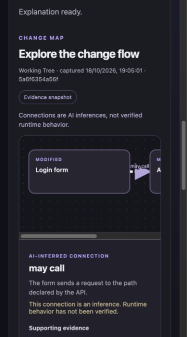

# VibeCodeFolks

**AI wrote it. Do you understand it?**

VibeCodeFolks is a local, open-source developer tool for understanding changes made by AI coding agents. It shows Git changes across programming languages and can request an optional evidence-backed explanation from an OpenAI-compatible provider.

## Get started

Install Git and Go 1.21 or later. From this project directory:

```sh
go run . /path/to/project
```

The argument can point anywhere inside a Git repository and defaults to the current directory. The CLI opens a local browser dashboard; if it cannot, open the printed URL. Stop the server with Ctrl+C.

```sh
go vet ./...
go test ./...
go build -o vibecodefolks .
./vibecodefolks /path/to/project
```

The dashboard assets are embedded in the executable. Node.js, Python, Electron, a database, and accounts are not required.

## Git changes

The dashboard shows the combined working-tree diff from `HEAD`, plus untracked non-ignored files. When the tree is clean it displays **Last Commit**, compared to its first parent. Initial commits, repositories without commits, detached HEAD, renames, and binary files are supported. Refresh reruns Git analysis. Changes canceled between the index and working tree can have no combined difference; a warning is shown. Staged deletions followed by an untracked replacement are shown once with unavailable net statistics.

## Optional AI explanation

Set these environment variables before starting the CLI:

```sh
export VIBECODEFOLKS_AI_ENDPOINT="http://127.0.0.1:11434/v1/chat/completions"
export VIBECODEFOLKS_AI_MODEL="your-model-name"
# For remote providers, also set VIBECODEFOLKS_AI_API_KEY in your shell.
./vibecodefolks /path/to/project
```

Use the provider's full chat-completions URL. Remote endpoints require HTTPS and an API key; loopback endpoints can use HTTP and do not require a key. Providers must support OpenAI-compatible chat completions and JSON object responses. No AI request is made when the dashboard opens. Click **Explain Changes**, review the evidence and provider details, then explicitly send it. Remote providers require the consent checkbox. Canceling a provider request cancels the HTTP call where possible.

The server collects unified diff hunks with three lines of surrounding context, including untracked additions, and up to eight straightforward single-line import statements from each current file. It sends the selected file paths, diff excerpts, line references, scope, and limitations to the provider. It excludes binary files, symlinks, common credential filenames, detected secret patterns, oversized files and diffs, and files beyond configured limits. At most 20 files, 32 KiB per file/diff, and 160 KiB total diff text are included. The serialized provider evidence is additionally capped at 512 KiB. Skipped files and reasons are displayed. Secret detection is **best effort** and cannot guarantee all sensitive information is removed: inspect the preview before sending. Your provider may retain submitted data. The local server does not log source snippets, prompts, or keys.

Git filter and filesystem monitor commands are disabled during analysis. The server listens only on `127.0.0.1`, checks the request host and origin, and does not accept arbitrary project paths via the API. It is designed for a trusted local machine, not as a multi-user server.

### Visual change flows

After the explanation is ready, the change map uses the same evidence snapshot to show suggested components and connections. Select a card or arrow with the mouse or keyboard to see its description, uncertainty, and supporting diff excerpts. For example, a change to `web/login.js` and `api/auth.py` might show **Login form → Authentication API** when both files contain relevant evidence. The arrow is an AI inference; matching paths do not prove the request works at runtime. The screenshot below uses a scripted mock provider and a sample repository.



The snapshot timestamp and identifier describe the evidence sent to the provider. Refreshing Git changes clears the previous explanation and diagram; run **Explain Changes** again to analyze the new snapshot. If the provider omits a graph or returns an invalid one, the explanation remains available and the map shows disconnected file cards based on the collected evidence. It does not invent connections. Currently all displayed connections are AI inferences; no deterministic relationship extraction is performed. The map accepts at most 20 nodes and 30 edges, so larger changes may be summarized or fall back to file cards. Scroll the diagram horizontally for wide flows.

### Example output

For a diff that adds a `validateEmail` function, an explanation might say:

- **What changed:** Added a function that checks whether an email is present, citing the added lines.
- **Why it matters:** The check may prevent empty submissions; this is an inference.
- **What we couldn't verify:** Whether all callers use the function and how the application behaves at runtime.

AI output is an interpretation, not a test result. The server checks that each finding cites a real line included in its evidence; a valid citation does not guarantee the model interpreted that line correctly.

## Limitations

Evidence is language-independent text, not a full parser for every language or framework. Only changed diff context is supplied; unchanged files, large changes, pure renames without textual hunks, binary content, submodules, symlinks, and other skipped material may be missing. The provider may fail, return invalid JSON or invalid references, or misunderstand valid evidence; invalid structured responses are rejected. Filters are heuristic, and files can change during analysis. Unmerged conflicts must be resolved first. The app does not execute or test the project and cannot confirm runtime behavior. Citations establish that the referenced lines exist in the supplied evidence, not that an inferred relationship is correct. Quizzes are not implemented.

## License

MIT. See [LICENSE](LICENSE).
