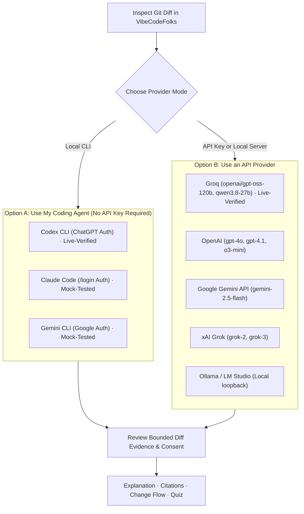

# VibeCodeFolks

**AI wrote it. Do you understand it?**

AI tools can write hundreds of lines of code in seconds. Reviewing those changes line-by-line is exhausting, and it is easy to miss subtle concurrency bugs, state mutations, and API contract mismatches.

VibeCodeFolks is a local code-understanding tool for developers reviewing AI-generated Git changes. It turns raw diffs into clear, evidence-backed explanations, visual change flows, and interactive comprehension quizzes.

One Go executable. A local browser dashboard. Zero cloud accounts, databases, or frontend runtimes required.


> **Screenshot context:** Captured from a local repository review. The screenshot and examples use non-confidential sample code and genuine inference results.

---

## Why VibeCodeFolks?

VibeCodeFolks is not an autonomous coding agent, a code generator, or a generic chat window. It is built for a single job: **helping you understand and verify unfamiliar changes before you merge**.

- **Understand what changed:** Get a structured summary that distinguishes core logic changes, potential runtime impacts, and inferred connections.
- **Trace behavior with exact line citations:** Every finding links directly to lines in the reviewed diff. Click any citation to jump to the exact code and inspect surrounding context.
- **Explore inferred change flows:** View an interactive relationship map showing how modified files, handlers, and hooks connect across your project.
- **Identify risks and edge cases:** Flags subtle bugs (such as missing return fields, state mutation side effects, and boundary conditions) that standard diff viewers miss.
- **Test your comprehension:** Generate an evidence-backed quiz tailored to the changes. When you pick a wrong answer, the quiz explains the exact misconception and cites the supporting diff lines.

---

## Quick Start

### 1. Build and Run from Source (Recommended for latest `main`)

Requires [Go 1.21+](https://go.dev/dl/) and [Git](https://git-scm.com/):

```sh
git clone https://github.com/BHAVIKA44/vibecodefolks.git
cd vibecodefolks
go run . /path/to/your/project
```

Or install the binary to your Go bin path:

```sh
go install github.com/BHAVIKA44/vibecodefolks@main
vibecodefolks /path/to/your/project
```

### 2. Install Stable Release (macOS & Linux)

To install the latest published stable release (`v0.1.0`):

```sh
curl -fsSL https://raw.githubusercontent.com/BHAVIKA44/vibecodefolks/main/install.sh | sh
```

The script verifies SHA-256 checksums from the [Releases](https://github.com/BHAVIKA44/vibecodefolks/releases) page and installs to `~/.local/bin`. Set `VIBECODEFOLKS_INSTALL_DIR` to choose a custom directory.

> **Note on Releases:** The installer currently downloads release `v0.1.0`. To use the newest coding-agent integrations (**Codex CLI**, **Claude Code**, and **Gemini CLI**) and dynamic model discovery merged on `main`, build from source with `go run .` or `go install`.

### 3. Install Stable Release (Windows PowerShell)

For Windows (Git must already be installed):

```powershell
$tag = 'v0.1.0'
$asset = "vibecodefolks_${tag}_windows_amd64.zip"
$base = "https://github.com/BHAVIKA44/vibecodefolks/releases/download/$tag"
$dir = Join-Path $env:USERPROFILE '.local\bin'
New-Item -ItemType Directory -Force $dir | Out-Null
$tmp = Join-Path ([System.IO.Path]::GetTempPath()) ([System.Guid]::NewGuid().ToString())
New-Item -ItemType Directory $tmp | Out-Null
try {
  Invoke-WebRequest "$base/$asset" -OutFile "$tmp/$asset"
  Invoke-WebRequest "$base/checksums.txt" -OutFile "$tmp/checksums.txt"
  $lines = @(Get-Content "$tmp/checksums.txt" | Where-Object { $_.EndsWith("  $asset") })
  if ($lines.Count -ne 1 -or $lines[0] -notmatch '^[0-9a-f]{64}  ') { throw 'Missing or invalid checksum' }
  if ((Get-FileHash "$tmp/$asset" -Algorithm SHA256).Hash.ToLower() -ne $lines[0].Substring(0, 64)) { throw 'Checksum mismatch' }
  Expand-Archive "$tmp/$asset" -DestinationPath "$tmp/extracted"
  Move-Item -Force "$tmp/extracted/vibecodefolks.exe" "$dir/vibecodefolks.exe"
} finally { Remove-Item -Recurse -Force $tmp }
& "$dir/vibecodefolks.exe" --version
```

### CLI Usage

```sh
# Analyze current repository and open browser automatically:
vibecodefolks .

# Analyze a specific repository without opening a browser:
vibecodefolks --no-open /path/to/project
```

The local server listens on `127.0.0.1` on a dynamically assigned port. Press `Ctrl+C` in your terminal to stop it.

---

## Connecting an AI Model

VibeCodeFolks is completely model-agnostic. You can either reuse your existing coding-agent CLI login or configure an API provider.



### Option A: Use My Coding Agent (Local CLIs)

If you already use a coding assistant, VibeCodeFolks can delegate explanation generation to your installed CLI. **No API key entry or credit card is required in VibeCodeFolks.**

| Coding Agent | CLI Tool | Authentication | Verification Status | Notes |
| :--- | :--- | :--- | :--- | :--- |
| **OpenAI Codex CLI** | `codex` (`@openai/codex`) | Run `codex login` (ChatGPT non-billable login) | **Live-Verified** | Tested with real multi-file repositories and full quiz workflows using `gpt-6.1-sol`. |
| **Anthropic Claude Code** | `claude` (`@anthropic-ai/claude-code`) | Run `claude` and complete `/login` | **Implemented & Mock-Tested** | Runs in non-interactive `plan` mode. Marked unverified until live inference completes. |
| **Google Gemini CLI** | `gemini` (`@google/gemini-cli`) | Run `gemini auth login` or set `GEMINI_API_KEY` | **Implemented & Mock-Tested** | Runs in non-interactive read-only approval mode. Marked unverified until live inference completes. |

#### Safety Guarantees for Local CLIs:
- **Strictly read-only:** CLIs are invoked in freshly created, empty temporary directories (`os.MkdirTemp`). The CLI cannot write to or modify your repository files.
- **Forbidden dangerous flags:** Flags such as `--dangerously-bypass-approvals-and-sandbox`, `--approve-for-me`, `yolo`, and `auto_edit` are prohibited and blocked by unit test assertions.
- **Privacy notice:** Although VibeCodeFolks runs the CLI process locally, the CLI itself communicates with its upstream AI service (OpenAI, Anthropic, or Google) under your existing account. Review the evidence preview before sending.

### Option B: Use an API Provider

You can also connect directly to hosted or local model providers:

- **Groq:**
  - `openai/gpt-oss-120b`: **Live-Verified** across Go, Python, and Java repositories with strict JSON Schema output. Recommended default.
  - `qwen/qwen3.8-27b`: **Live-Verified** with fast generation (4.2s) and 3/3 dedicated quiz questions.
  - *Note on 20B:* `openai/gpt-oss-20b` was unreliable during live testing due to schema formatting violations on Groq; it is **not recommended**.
- **OpenAI API:** Compatible with `gpt-4o`, `gpt-4.1`, `o1`, `o3`, and `o3-mini`.
- **Google Gemini API:** Compatible with `gemini-2.5-flash` and `gemini-2.5-pro` using OpenAI-compatible endpoints.
- **xAI Grok:** Compatible with `grok-2` and `grok-3` via the Responses API.
- **Ollama & LM Studio:** Compatible with local models running on `http://localhost:11434` or `http://localhost:1234`. No API keys required.

#### Dynamic Model Discovery & Session Memory:
- Click **"Load models"** to discover available models from your provider without making billable inference calls. Audio (`whisper*`), safety guardrail, and non-chat models are automatically filtered.
- API keys and verification statuses persist in local server memory across model switches during your session.

#### Environment Variable Shortcuts:
```sh
# If GROQ_API_KEY is present, VibeCodeFolks automatically configures Groq (openai/gpt-oss-120b):
export GROQ_API_KEY="your-groq-api-key"
vibecodefolks .

# Custom OpenAI-compatible endpoint:
export VIBECODEFOLKS_AI_ENDPOINT="https://generativelanguage.googleapis.com/v1beta/openai/chat/completions"
export VIBECODEFOLKS_AI_MODEL="gemini-2.5-flash"
export VIBECODEFOLKS_AI_API_KEY="your-gemini-api-key"
vibecodefolks /path/to/project
```

---

## How It Works in Practice

### 1. Bounded Diff Evidence Collection
VibeCodeFolks inspects your Git working tree and collects unified diff hunks with 3 lines of surrounding context, plus untracked files and up to 8 import statements per file.
- **Sensitive file protection:** Excludes `.env` files, known secret patterns, private keys, binary files, symlinks, and oversized diffs.
- **Evidence preview:** You see the exact text that will be sent *before* any model is contacted.


### 2. Inferred Change Flow Graph
When an explanation is generated, VibeCodeFolks maps relationships between changed components (e.g. `PATCH contract` between an API route and a client sync hook).
- Graph nodes and edges are explicit AI inferences, never invented file cards.
- Supports interactive zoom, pan, and node inspection.

### 3. Understanding Quiz & Misconception Explanations
Choose **"Test my understanding"** to generate an evidence-backed quiz.
- Every question includes multiple choices with **distractor misconception explanations**: if you pick an incorrect answer, it explains *why* that choice was wrong based on the code.
- **Zero-network retry:** Retrying reuses the generated questions directly in browser memory without making extra provider calls.
- Questions and answer keys cite exact line ranges in the diff.


---

## Scope & Limitations

- **Working-Tree-Only Scope (v1.0.0):** VibeCodeFolks inspects the current uncommitted working-tree diff against `HEAD` (or the last commit if the working tree is clean). Arbitrary revision range comparisons (`git diff branchA..branchB`) are planned for a future release.
- **AI Output is an Interpretation:** AI summaries and quiz questions are models' interpretations of text diffs, not runtime execution proofs. Always verify critical behavior with your test suite.
- **Diff Boundaries:** Diff context is capped at 20 files, 32 KiB per file/diff, and 160 KiB total diff text. Larger changes will be summarized with omitted hunks flagged.
- **Unverified Configurations:** While wire contracts are implemented for all listed providers, live end-to-end inference has been verified on `Codex CLI` (`gpt-6.1-sol`), `Groq` (`openai/gpt-oss-120b`), and `Groq` (`qwen/qwen3.8-27b`). Other models and CLIs are marked unverified until tested.

---

## Benchmarks & Performance

Measured on a Linux ARM64 Docker VM:
- **Warm dashboard startup (p50):** 6.3–6.5 ms.
- **Git analysis on 10,001-file fixture (p50):** 595 ms.
- See [`docs/benchmarks.md`](docs/benchmarks.md) for full benchmark methodology and data.

---

## Development & Contributing

### Prerequisites
- [Go 1.21+](https://go.dev/dl/)
- [Node.js 20+](https://nodejs.org/) (for frontend unit tests only; no Node runtime is needed to run VibeCodeFolks)

### Running Tests Locally

```sh
# Clone repository
git clone https://github.com/BHAVIKA44/vibecodefolks.git
cd vibecodefolks

# Verify Go formatting and vet
test -z "$(gofmt -l .)"
go vet ./...

# Run Go test suite with race detector
go test -race ./... -count=1

# Check JavaScript syntax and run dashboard tests
node --check web/app.js web/graph.js web/quiz.js
node --test tests/dashboard.test.cjs

# Run installer test script
sh tests/installer.sh
```

### Documentation & QA Reports
- [`docs/final-prelaunch-qa.md`](docs/final-prelaunch-qa.md): Complete pre-launch engineering report and benchmark comparison against px0.
- [`docs/multi-model-compatibility.md`](docs/multi-model-compatibility.md): Model compatibility matrix and parameter flags.
- [`docs/live-inference-manual-qa.md`](docs/live-inference-manual-qa.md): Multi-scenario live inference findings across Go, Python, Java, and TypeScript.
- [`docs/benchmarks.md`](docs/benchmarks.md): Startup and Git analysis benchmark results.

---

## License

[MIT](LICENSE) © 2026 Bhavika
